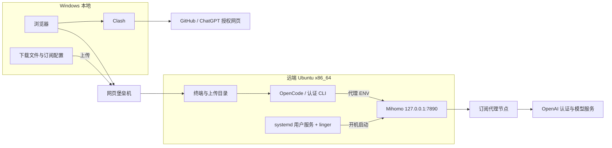

# 远程 Ubuntu 部署 OpenCode：Mihomo 代理、ChatGPT 登录与开机自启

最小路线：Windows 本地 Clash → 网页堡垒机上传文件 → Ubuntu 运行 Mihomo → OpenCode 经远端代理登录 ChatGPT。

适用前提：远端为 Ubuntu x86_64，已安装 OpenCode；使用同一个普通用户完成部署和认证，具备启用 linger 所需权限。

> 本文按会话请求中列出的已走通路径整理。原聊天完整执行记录不可读取，未在目标机器重新执行验证；尤其不将版本相关的 OpenCode 服务命令视为已验证有效。

## 网络拓扑



Windows Clash 负责本地网络访问；它不会自动代理远端 Ubuntu。远端 OpenCode 使用的是远端自己的 `127.0.0.1:7890`，无需开放公网代理端口或做本地端口转发。

## 1. 本地下载，堡垒机上传

**【本地 Windows · 浏览器】**

1. 开启 Clash，访问 [Mihomo v1.19.33 官方发布页](https://github.com/MetaCubeX/mihomo/releases/tag/v1.19.33)。
2. 下载 Linux x86_64 的 `mihomo-linux-amd64-v1-v1.19.33.gz`（选择 **amd64-v1**，不是 arm64）。
3. 准备 Clash 订阅对应的完整 `config.yaml`，以及与其 GeoIP 格式匹配的 `geoip.metadb`。配置必须包含实际节点，不能只是订阅 URL 或网页内容。
4. 通过网页堡垒机，把上述三个文件上传到远端用户的 `~/upload/`。若堡垒机使用其他上传目录，先将文件放到此处。

这些文件可能包含订阅地址和节点密码，仅放在自己的机器上，不要提交到 GitHub。

## 2. 远端安装并测试 Mihomo

**【远端 Ubuntu · Bash】**

```bash
uname -m  # 应为 x86_64
mkdir -p "$HOME/.local/bin" "$HOME/.config/mihomo"
gzip -dc "$HOME/upload/mihomo-linux-amd64-v1-v1.19.33.gz" > "$HOME/.local/bin/mihomo"
chmod 700 "$HOME/.local/bin/mihomo"
cp "$HOME/upload/config.yaml" "$HOME/.config/mihomo/config.yaml"
cp "$HOME/upload/geoip.metadb" "$HOME/.config/mihomo/geoip.metadb"
chmod 700 "$HOME/.config/mihomo"
chmod 600 "$HOME/.config/mihomo/config.yaml"
"$HOME/.local/bin/mihomo" -v
```

编辑远端 `~/.config/mihomo/config.yaml`，修改已有的同名顶层字段，避免重复；保留原订阅的节点、代理组和规则：

```yaml
mixed-port: 7890
allow-lan: false
bind-address: 127.0.0.1
geodata-mode: false
```

本路线使用 `geoip.metadb`，因此使用非 geodata 的 GeoIP 模式。配置中的代理组也必须选择可用节点，并让 OpenAI 请求命中代理规则。

**【远端 Ubuntu · Bash】**

```bash
"$HOME/.local/bin/mihomo" -t -d "$HOME/.config/mihomo"
```

测试成功后再启动。此测试检查配置及所需资源，不代表已验证 OpenAI 登录可用；若配置还引用其他规则或数据文件，按报错补齐。

## 3. 设置 Mihomo 开机自启

**【远端 Ubuntu · Bash】**

```bash
mkdir -p "$HOME/.config/systemd/user"
cat > "$HOME/.config/systemd/user/mihomo.service" <<'EOF'
[Unit]
Description=Mihomo local proxy

[Service]
Type=simple
ExecStart=%h/.local/bin/mihomo -d %h/.config/mihomo
Restart=on-failure
RestartSec=5

[Install]
WantedBy=default.target
EOF

systemctl --user daemon-reload
systemctl --user enable --now mihomo.service
sudo loginctl enable-linger "$USER"
loginctl show-user "$USER" -p Linger
systemctl --user is-enabled mihomo.service
systemctl --user is-active mihomo.service
ss -lnt 'sport = :7890'
```

预期分别看到 `Linger=yes`、`enabled`、`active`，且代理监听 `127.0.0.1:7890`。linger 使用户服务可在开机后启动，并在退出堡垒机会话后继续运行。没有相应权限时，请管理员为该用户启用。

## 4. 配置 OpenCode 代理 ENV

**【远端 Ubuntu · Bash】** 先确认版本和实际支持的命令：

```bash
opencode --version
opencode --help
```

优先使用用户偏好的 **`opencode service set env` 持久化方式，但仅限当前版本确实支持时**。先从本机帮助确认存在 `service`、`set`、`env` 子命令，再按该版本说明保存以下值，并按说明重启对应 OpenCode 服务：

```dotenv
HTTP_PROXY=http://127.0.0.1:7890
HTTPS_PROXY=http://127.0.0.1:7890
NO_PROXY=localhost,127.0.0.1,::1
```

以上是 ENV 值清单，不是可直接执行的 Shell 命令。`HTTPS_PROXY` 使用 `http://`，表示通过 HTTP 代理建立 HTTPS 隧道。

> 尚未确认当前 OpenCode 版本支持 `opencode service set env`，因此本文不提供臆测的参数格式。若帮助中不存在该命令，此持久化步骤不适用，不能将其记为已配置成功；临时认证成功也不能证明服务已保存 ENV。

服务 ENV 不会自动进入另行运行的认证 CLI。下一步仅给认证进程临时传入代理，不必为整个终端设置代理。

## 5. 使用 ChatGPT 设备码登录

**【本地 Windows · 浏览器】** 登录自己的 ChatGPT，在 **Settings → Security** 启用 **Device Code Authentication**（名称以当前界面为准）。工作区账号若受限制，需要管理员允许。该前提见 [OpenAI 设备码认证说明](https://learn.chatgpt.com/docs/auth#preferred-device-code-authentication-beta)。

**【远端 Ubuntu · Bash】**

```bash
HTTP_PROXY=http://127.0.0.1:7890 \
HTTPS_PROXY=http://127.0.0.1:7890 \
NO_PROXY=localhost,127.0.0.1,::1 \
opencode auth login
```

在交互菜单中选择 **OpenAI → Codex device code (legacy)**。这是本路线对应版本的菜单项；如果当前版本没有该项，不要假定它仍受支持。

**【本地 Windows · 浏览器】** 打开远端 CLI 实际显示的官方验证链接，输入当次设备码，完成授权。随后等待远端 CLI 提示登录完成。

**【远端 Ubuntu · Bash】**

```bash
opencode auth list
```

确认列表中出现对应的 OpenAI 认证记录，再在 OpenCode 中选择可用的 OpenAI 模型发起一次简单请求。认证记录存在与模型请求成功是两项独立检查。

`auth login` 入口参考 [OpenCode CLI 文档](https://opencode.ai/docs/cli/#auth)；`auth list` 及具体登录菜单以本机 `opencode auth --help` 和实际界面为准。

## 简短排错

| 现象 | 含义与处理 |
| --- | --- |
| `403` | 请求被目标站点、网关或策略拒绝，不等于代理没有启动。看清返回来源；登录阶段检查设备码认证开关和账号权限，再检查远端代理节点出口及规则。仅凭 403 不能断言账号被封。 |
| `GeoIP timeout` | Mihomo 在启动或配置测试时获取 GeoIP 数据超时。确认本地上传的 `geoip.metadb` 位于 `~/.config/mihomo/`、文件名和格式正确、`geodata-mode: false`，然后重跑 `mihomo -t`。 |
| `unknown command: service` | 当前 OpenCode 不支持文中的条件式服务 ENV 方式；不能继续照抄或宣称持久化成功。 |
| `Connection refused`，目标为 `127.0.0.1:7890` | Mihomo 未运行或端口配置不一致，检查用户服务和监听地址。 |

**【远端 Ubuntu · Bash】** 查看 Mihomo 日志：

```bash
journalctl --user -u mihomo.service -n 50 --no-pager
```

本文的开机自启配置针对 **Mihomo**；OpenCode 服务是否自启、是否持久保存代理 ENV，需以所安装版本的实际服务功能和检查结果为准。README 不含真实订阅、设备码、Token 或账号凭据。
